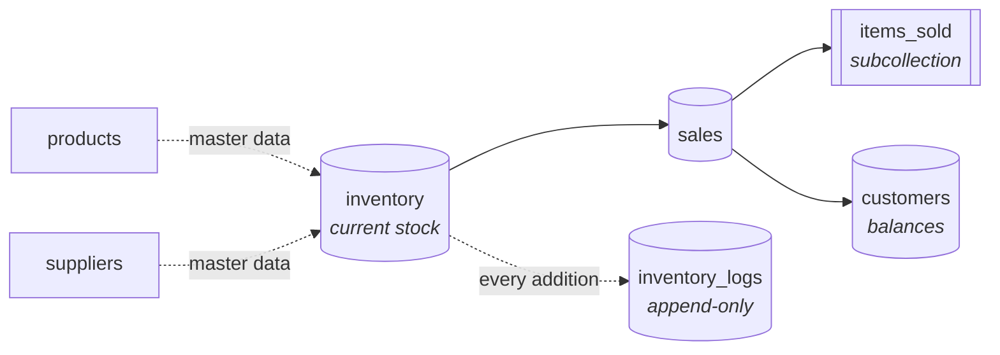

<div align="center">


# AgriMedTrack

**Inventory, sales, and stock audits for the agri-input shop — minus the ledger book with coffee rings.**

Built for Patel Krishi Kendra. Fluent in fertilizers, pesticides, and batch numbers.

<br />

[](https://expo.dev)
[](https://reactnative.dev)
[](https://www.typescriptlang.org)
[](https://firebase.google.com)
[](LICENSE)
[](#-status)

[Features](#-features) · [Status](#-status) · [Quick Start](#-quick-start) · [Architecture](#-architecture) · [Contributing](#-contributing)

</div>

<br />

## 🌱 Why

A small agri-input shop handles hundreds of products, dozens of suppliers, a batch number on every bag, and an expiry date on every bottle. Usually all of that lives in a notebook and in one person's memory.

AgriMedTrack moves it to a phone. You can see what's in stock and what's about to expire, and the app keeps a record of where everything went.

<br />

## ✨ Features

|     | Feature | What it does |
| :-: | :------ | :----------- |
| 📊 | **Live Dashboard** | Real-time KPIs, low-stock and expiry alerts, top products, and recent activity. |
| 📦 | **Inventory** | Searchable stock with batch, packaging, expiry, and stock-value at a glance. |
| ➕ | **Add Stock** | Multi-item entry with cascading *Product → Supplier → Packaging → Batch* selection. |
| 🧾 | **Sales** | Transaction history with customer, payment status, and profit tracking. |
| 📜 | **Audit Log** | An append-only trail of every stock addition. History, but with receipts. |
| 🔐 | **Auth** | Firebase email/password sign-in with a session that remembers you. |

<br />

## 🚦 Status

> **Growing season.** The roots are healthy and the harvest is not quite in yet.

| Area | State |
| :--- | :---: |
| Dashboard, Inventory, Sales views, Audit logs | 🟢 Working |
| Authentication with persisted sessions | 🟢 Working |
| Add Inventory (writes to Firestore) | 🟡 Works, not yet atomic |
| Add Sale (form and validation) | 🟡 UI complete, submit is a placeholder |
| Edit and delete sales, Reports | ⚪ Planned |
| Cloud Functions for transactional writes | ⚪ Planned |

It's ready for internal use and demos. It isn't ready to run a shop's books on yet.

<br />

## 🚀 Quick Start

**You'll need:** Node.js 18+, npm, the Expo tooling for your platform, and a Firebase project with **Authentication (Email/Password)** and **Firestore** turned on.

```bash
git clone https://github.com/CPT-Dawn/AgriMedTrack.git
```

```bash
cd AgriMedTrack && npm install
```

Point the app at your own Firebase project by replacing the config in [`services/firebase.ts`](services/firebase.ts). Then:

```bash
npm start
```

| Script | Does |
| :----- | :--- |
| `npm start` | Starts the Expo dev server |
| `npm run android` | Builds and runs on Android |
| `npm run ios` | Builds and runs on iOS (macOS only, sadly) |
| `npm run web` | Runs in the browser |

> [!TIP]
> Empty database? The dev-only seed helpers in [`utils/`](utils/) will fill it with sample data so you're not demoing to an empty screen.

<br />

## 🏗 Architecture

The data model is **denormalized on purpose**. Screens read once and render. There are no join-style lookups chaining across collections.



- **State and history are kept apart.** `inventory` holds what you have now. `inventory_logs` holds how you got there.
- **Every sale is self-contained.** Product names and prices are copied into the sale record at the moment it happens, so last year's profit stays correct after this year's price changes.
- **Line items live in a subcollection.** A big sale will never run into Firestore's 1 MB document limit.
- **Screens update live.** The main hooks use `onSnapshot`, so changes show up without a pull-to-refresh.

The full schema is in [`docs/datadesign.md`](docs/datadesign.md).

<details>
<summary><b>📁 Project structure</b></summary>

<br />

```
AgriMedTrack/
├── App.tsx          # Bootstrap, navigation, providers
├── screens/         # Dashboard, Inventory, Sales, Add*, Logs, Login
├── components/      # Cards, forms, chips, dialogs, toasts
├── hooks/           # Data hooks (Firestore listeners) + UI helpers
├── services/        # Firebase initialization
├── theme/           # Color and font tokens
├── types/           # Shared TypeScript models
├── utils/           # Dev-only seed data
└── docs/            # Design and implementation notes
```

</details>

<details>
<summary><b>🧰 Tech stack</b></summary>

<br />

**Expo** · **React Native** · **TypeScript** · **Firebase Auth** · **Cloud Firestore** · **React Navigation** · **Gluestack UI** · **Reanimated** · **Lottie** · **AsyncStorage**

Type set in **Montserrat** (headlines) and **Lato** (body). Colors are *Patel Blue* `#0540F2`, *Growth Green* `#6A7C5F`, and *Vibrant Orange* `#F26101`.

</details>

<br />

## 🗺 Roadmap

- [ ] Cloud Function–backed sales and stock mutations, so writes are all-or-nothing
- [ ] Edit and delete sales
- [ ] Reports and exports
- [ ] Offline-first improvements
- [ ] Hardened Firestore security rules

<br />

## 🤝 Contributing

Contributions are welcome. Start with [**CONTRIBUTING.md**](CONTRIBUTING.md), which covers setup, conventions, and how to open a pull request. Please read the [Code of Conduct](CODE_OF_CONDUCT.md), and report vulnerabilities privately as described in [SECURITY.md](SECURITY.md).

<br />

## 📄 License

[MIT](LICENSE) © Swastik Patel. You can use it, fork it, or plant it somewhere new.

<br />

<div align="center">
<sub>Made with ☕ and a healthy respect for expiry dates.</sub>
</div>
